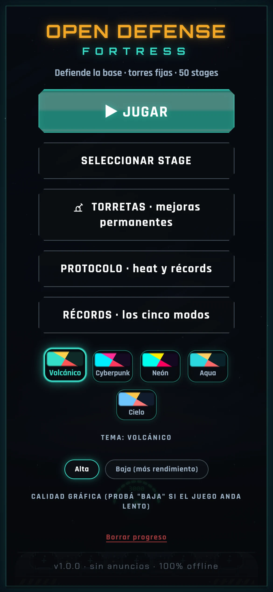
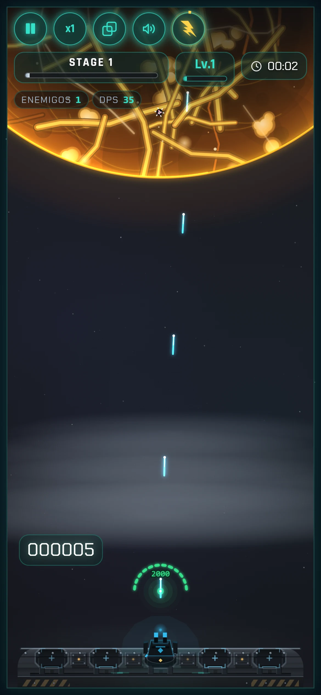
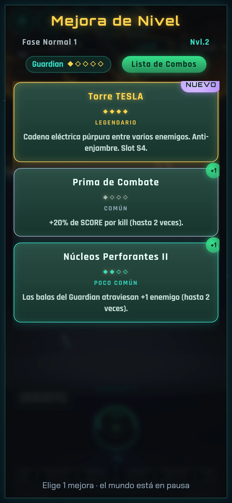

# Open Defense Fortress

**Tower defense roguelike de torres fijas, 100% offline y sin dependencias de runtime.**

[](https://github.com/Javierkaiser/open-defense-fortress/actions/workflows/ci.yml)
[](LICENSE)
[](package.json)
[](tests/)

[Demo web](https://opendefensefortress.javierlust.net.ar/) · [English summary](README.en.md) · [Diseño técnico](docs/DESIGN.md) · [Balance](docs/BALANCE.md) · [Testing](docs/TESTING.md) · [Créditos](docs/CREDITS.md) · [Cómo contribuir](CONTRIBUTING.md) · [Código de conducta](CODE_OF_CONDUCT.md)



## Qué es

Defendés una base volcánica de una lluvia de meteoritos, enjambres pétreos,
esporas, cristales, virus y tanques de cada familia. Las torres se disparan
solas: vos gestionás la economía de la run, la
velocidad del tiempo, el Ultimate y las cartas de mejora que aparecen al subir
de nivel. Cada partida es un roguelike: el arsenal, las cartas y las oleadas
cambian.

El juego corre entero en el navegador: Canvas 2D para el mundo, DOM/CSS para el
HUD y los overlays, módulos ES y `localStorage` para el progreso. No hay build
step, no hay servidor y no hay llamadas de red.

## Jugar / correr

La forma más rápida es la [demo web](https://opendefensefortress.javierlust.net.ar/): no
requiere instalación y funciona offline después de la primera carga.

| URL pública | Qué es |
|---|---|
| <https://opendefensefortress.javierlust.net.ar/> | **Canónica** — el juego |
| <https://opendefensefortress.javierlust.net.ar/privacy.html> | Política de privacidad |
| <https://faint-desert-zjv5.here.now/> | Alias en here.now: sirve el mismo build |

El sitio vive en **here.now** con el dominio propio conectado; cada push a `main`
lo publica en las dos URLs a la vez.

Para correrlo desde el código hace falta un servidor estático, porque los módulos
ES no cargan desde `file://`:

```bash
git clone https://github.com/Javierkaiser/open-defense-fortress.git
cd open-defense-fortress
node scripts/serve.mjs 8080
# abrir http://localhost:8080
```

Requisitos: **Node 22+** (solo para servir y para los tests; el juego no tiene
dependencias ni build step). Alternativas de servidor:

```bash
python3 -m http.server 8080
npx serve .
```

La demo se publica sola: cada push a `main` corre el workflow de deploy
(`.github/workflows/deploy-herenow.yml`).

## Capturas





## Features

- **Campaña de 50 etapas** con jefes, biomas y dificultad creciente.
- **Modo infinito** (etapas 51+) con profundidad, hitos y récord.
- **Supervivencia**: olas infinitas, atrición de base y jefe cada 5 oleadas.
- **Desafío diario** con semilla por fecha.
- **Protocolo / Heat**: 11 condiciones, presets I–V y recompensas extra.
- **8 torres + 3 drones**, cada una con una **mecánica firma** (supresión, fusión, juicio, ion, cráter, riel, corte, ignición, veneno y burbuja), 84 cartas, 7 afijos de élite y 5 temas visuales con **skins de torres** (paleta, motivos, pad y FX por tema).
- **Progresión con decisiones**: una cuenta nueva arranca solo con **Guardian**; las otras 10 unidades se desbloquean con oro. Los fragmentos son un **pool compartido**, así que subir una torreta deja menos para las demás.
- **4 familias de enemigos** con enjambre y tanque propios (roca, virus,
  espora y cristal), cada una con su mecánica.
- **Sin anuncios, sin compras, sin cuentas, sin telemetría.**
- **Offline real**: fuentes, sprites y SFX locales.
- **Calidad gráfica Alta/Baja** para equipos modestos.
- **1026 tests** en Node, sin DOM ni canvas.

## Controles

| Acción | Teclado | Touch |
|---|---|---|
| Jugar / navegar menús | `Enter` | Tap en los botones |
| Pausa / continuar | `P` o `Esc` | Botón de pausa del HUD |
| Velocidad ×1 / ×1.5 / ×2 | `1` `2` `3` | Botón `x1` del HUD |
| Ultimate (ORBITAL STRIKE) | `Espacio` | Botón circular |
| Black Hole | `B` | Botón `◉` del HUD |
| Combo List | `U` | Botón de cartas del HUD |
| Música on/off | `M` | Botón de música |

El disparo es automático: no hay apuntado ni joystick.

## Tests

```bash
node --test "tests/test-*.mjs"            # 1026 tests (1026 pass, 0 skip, 0 fail)
node .github/scripts/ci-checks.mjs   # checks estáticos (sintaxis, zero-dep, refs)
```

La suite corre sobre los módulos reales en Node, sin canvas, DOM, audio ni
jsdom. Cubre fórmulas, economía, cartas, oleadas, etapas, enemigos, torres,
meta-juego, HUD (markup puro), progreso, heat, infinito, supervivencia y un
smoke de integración del motor. Ver [docs/TESTING.md](docs/TESTING.md).

La CI corre la suite en **Linux, macOS y Windows** con **Node 22 y 24**
(`.github/workflows/ci.yml`), más un job de checks estáticos. Cualquier PR tiene
que pasar esa matriz para mergearse.

## Estructura

```text
.
├─ index.html            # canvas + HUD DOM + overlays
├─ css/style.css         # HUD, pantallas, temas, responsive
├─ js/                   # 24 módulos ES (juego + puente nativo)
├─ assets/               # solo los 33 assets que usa el juego
├─ tests/                # node:test
├─ scripts/              # serve, balance-sim, probe-waves, probes
├─ tools/tower-sheet.html# hoja de contactos del arte de torres
├─ mobile/               # wrapper Android (Capacitor 8) + CI
├─ docs/                 # diseño, balance, testing, créditos, screenshots
├─ openspec/specs/       # specs de comportamiento
└─ .github/              # CI, deploy here.now, Android CI, templates y dependabot
```

## Arquitectura

- **Canvas 2D** lógico 540×880, escalado por CSS y DPR (tope 2).
- **DOM/CSS** para HUD, menús, cartas, pausa, meta, protocolo y récords.
- **24 módulos ES acíclicos** con un EventBus en `engine.js`; sin dependencias npm.
- **FSM de 12 estados** (`BOOT`, `MENU`, `SELECT_STAGE`, `PLAYING`, `PAUSED`,
  `CARD_CHOICE`, `STAGE_CLEAR`, `GAME_OVER`, `TORRETAS`, `PROTOCOLO`, `RECORDS`,
  `CREDITS`).
- **Director de olas** con presupuesto de HP, curva de presión, biomas por década
  y variantes de élite.
- **Persistencia** en `localStorage` (`gdf_progress`, `gdf_meta`, `gdf_quality`,
  `gdf_theme`).

Detalle completo en [docs/DESIGN.md](docs/DESIGN.md).

## Balance y herramientas

```bash
# simulador headless (muchas semillas; no da pass/fail)
node scripts/balance-sim.mjs --mode=inteligente --seeds=5

# sonda del director de olas (composición por etapa)
node scripts/probe-waves.mjs --seeds=20

# hojas de contacto del arte de torres
# http://localhost:8080/tools/tower-sheet.html
```

Los números del simulador son un piso, no un techo: sirven para comparar
tendencias. Ver [docs/BALANCE.md](docs/BALANCE.md).

## Android / Play Store

La **base Android** ya está en `mobile/` con Capacitor 8. El CI manual
“Android CI (debug)” compila un APK debug desde GitHub Actions, sin keystore ni
Play. Incluye back button nativo, pausa/audio al pasar a background,
keep-awake, safe areas y una pantalla de Créditos/Licencias.

Ver [docs/ANDROID.md](docs/ANDROID.md). La firma AAB, la service account y la
publicación en Play son la Etapa 3; cuando esté publicada, el link de Play va
acá.

## Licencia

El **código** está bajo [MIT](LICENSE): ese archivo contiene solo el texto
canónico de la licencia. Los **assets** tienen sus propias licencias (CC0, CC BY
3.0 y OFL 1.1); el detalle está en [THIRD_PARTY_NOTICES.md](THIRD_PARTY_NOTICES.md),
[docs/CREDITS.md](docs/CREDITS.md) y [docs/ASSETS.md](docs/ASSETS.md). En
particular, el icono del Ultimate es de **Lorc** (game-icons.net), CC BY 3.0,
recoloreado.

## Créditos

- Arte procedural: canvas vectorial del proyecto.
- Sprites y SFX CC0: Kenney (kenney.nl) y OpenGameArt.
- Icono Ultimate: Lorc / game-icons.net, CC BY 3.0.
- Fuentes: Orbitron, Rajdhani, Chakra Petch y Exo 2 (OFL 1.1).

Ver [docs/CREDITS.md](docs/CREDITS.md).

## Contribuir

Leé [CONTRIBUTING.md](CONTRIBUTING.md) y el
[código de conducta](CODE_OF_CONDUCT.md). El proyecto es deliberadamente
zero-dependency: no se agregan paquetes npm al runtime. Los cambios de UI
necesitan captura; los de lógica, tests.

Bugs y propuestas van por los [issue forms](.github/ISSUE_TEMPLATE/); los PRs
pasan por la matriz de CI (Linux/macOS/Windows × Node 22/24). Se aceptan
contribuciones en **español o inglés**.

## Seguridad y privacidad

No se recolectan datos. Para reportar una vulnerabilidad, usá el
[reporte privado de GitHub](https://github.com/Javierkaiser/open-defense-fortress/security/advisories/new)
o escribí a `contacto@javierlust.net.ar`; ver [SECURITY.md](SECURITY.md) y la
[política de privacidad](https://opendefensefortress.javierlust.net.ar/privacy.html).
