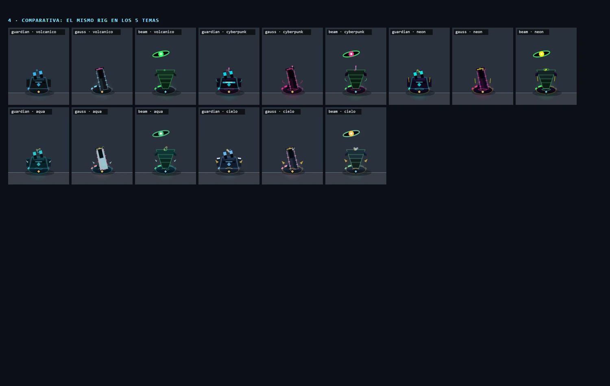

# Diseño técnico — Open Defense Fortress

Documento de referencia de la arquitectura y del gameplay. Para balance y
mediciones, ver [BALANCE.md](BALANCE.md); para la suite, [TESTING.md](TESTING.md).

## 1. Principios

1. **100% estático y offline.** Sin servidor, sin llamadas de red, sin build
   step y sin dependencias npm en runtime.
2. **Una sola pantalla de juego.** Canvas 2D lógico 540×880; el jugador no
   mueve una nave ni apunta. Las torres disparan solas.
3. **Portrait primero.** El HUD y los overlays se adaptan a marcos angostos y a
   pantallas con notch; el juego está pensado para celular.
4. **Roguelike por run.** El arsenal, las cartas y las oleadas cambian entre
   partidas. La meta-progresión es permanente, pero acotada.
5. **Cero monetización.** Sin anuncios, compras, cuentas, stamina ni moneda
   premium.
6. **Todo lo que se pueda testear sin DOM, se testea sin DOM.** Los módulos
   puros se ejecutan en Node; el rendering y el HUD se validan con smoke manual.

## 2. Stack y restricciones

| Área | Decisión |
|---|---|
| Runtime | Navegador moderno; HTML + CSS + JavaScript ES modules |
| Mundo | Canvas 2D, 540×880 lógicos, DPR con tope 2 |
| HUD/overlays | DOM + CSS (sin framework) |
| Loop | `requestAnimationFrame` + delta con clamp |
| Estado | FSM de 12 estados + `EventBus` en `engine.js` |
| Persistencia | `localStorage` (`gdf_progress`, `gdf_meta`, `gdf_quality`, `gdf_theme`) |
| Audio | WebAudio sintetizado + 18 samples OGG locales |
| Dependencias | Cero en runtime; solo herramientas Node en `scripts/` |
| Idioma | Español (UI, docs y comentarios) |

## 3. Estructura

```text
index.html              canvas + HUD DOM + overlays
css/style.css           HUD, pantallas, temas, responsive
js/                     56 módulos ES
assets/                 fuentes, SFX y sprites usados
tests/                  node:test
scripts/                serve, balance-sim, probe-waves, probes
tools/tower-sheet.html  hoja de contactos del arte de torres
docs/                   diseño, balance, testing, créditos
openspec/specs/         specs de comportamiento
```

## 4. Módulos

| Módulo | Responsabilidad |
|---|---|
| `main.js` | BOOT del navegador: crea Engine/HUD/Game, aplica calidad/tema y cablea el lifecycle. |
| `game.js` | `Game`: FSM, economía de la run, wiring de eventos y ciclo de partida (testeable sin DOM). |
| `engine.js` | Loop rAF+dt, canvas, `CONFIG`/`SCENE`, helpers (`clamp`, `dist`, `rand`), fondo, partículas, input, render y `EventBus`. |
| `waves.js` | Director de olas: presupuesto de HP, presión, biomas, variantes, `waveSchedule`, composición y vestido por run (`campaignWavesForRun`). |
| `waves-manager.js` | `WaveManager`, entrada de jefes y cola de spawns. |
| `waves-data.js` | Tablas manuales de olas de la campaña (stages 1..5), data pura. |
| `waves-formation.js` | Formaciones de entrada (V, arco, ola, racimo, columnas, pinza, espiral…), franjas y posiciones puras. |
| `waves-rng.js` | PRNG mulberry32, `hashSeed` y ruido determinista por índice para olas, spawn y jefe. |
| `stages.js` | 50 etapas de campaña: nombre, tema, HP de base, desbloqueo, jefe. |
| `endless.js` | Modo infinito (51+): `stageDef`, profundidad, hitos, recompensas y desafío diario. |
| `survival.js` | Supervivencia: olas infinitas, presupuesto lineal, jefes cada 5, temas y recompensas. |
| `heat.js` | Protocolo: 11 condiciones, presets, `heatMods()`, recompensas e hitos. |
| `enemies.js` | `Enemy`: comportamiento, movimiento y render. |
| `enemies-data.js` | Tipos, jefes, 7 variantes de élite y HP efectivo. |
| `enemies-boss.js` | Mecánicas firma de los jefes (lluvia, devorar, resurrección, placas y metamorfosis): reglas puras y pase de dibujo; expone el estado que lee la barra del jefe (`bossMechLabel`). |
| `enemies-status.js` | Veneno/quemadura, slow por fuente y marcas temporales. |
| `enemies-combat.js` | Colisión y daño de proyectiles (CCD, crítico, rebote, perforación). |
| `enemies-bestiary.js` | Icono real del enemigo para el bestiario. |
| `towers.js` | `Tower` + fachada de torres/drones/proyectiles/FX. |
| `towers-data.js` | Stats canónicas + `mech` (identidad firma) de cada unidad. |
| `tower-mechanics.js` | Registro de mecánicas firma y hooks (`onMechanicHit/Tick/Kill`, multiplicadores de marca). |
| `towers-core.js` | Mods efectivos, daño duck-typed y slow de explosiones. |
| `towers-targeting.js` | Targeting, aim, traverse y geometría de haz. |
| `towers-projectiles.js` | Bala, obús y misil. |
| `towers-fx.js` | Black Hole, Láser, Beam, Bolt y cráter del Mortar. |
| `towers-drones.js` | Drones orbitales: ignición, veneno y burbuja. |
| `player.js` | `Fortress`: base, slots, drones, HP/escudo, Black Hole y render de la plataforma. |
| `cards.js` | 108 cartas normales + 33 legendarias aparte, nivel/maestría, efectos, combos, ofertas y topes. |
| `cards-data.js` | Topes, tags de unidad, técnicas y cazas de familia. |
| `card-constants.js` | Multiplicadores compartidos por cartas y unidades futuras. |
| `combo-mods.js` | Schema único de los flags de combos. |
| `perks.js` | Única implementación de perks en combate: remate, robo de vida (tope 10 %), explosión al matar y `perk:proc`. |
| `combat-crit.js` | Crítico, stun y congelación compartidos por proyectil y haz. |
| `geometry.js` | Distancia/proyección punto-segmento y `withAlpha`. |
| `base-heal.js` | Única curación de la base, con guardas de no-resurrección. |
| `meta.js` | Meta-juego de 100 niveles: fragmentos, oro, perks por torre, rangos. |
| `progress.js` | Persistencia tolerante: desbloqueos, récords, modos, heat, daily. |
| `storage.js` | Acceso tolerante a `localStorage` compartido por meta/progress/theme/quality. |
| `score.js` | Fórmulas puras: score, XP, precio de nivel, multiplicadores, resumen de combo. |
| `economy.js` | Economía de una baja compartida por `Game`, `balance-sim` y `probe-s6`. |
| `hud.js` | Fachada pública del HUD (reexporta builders + clase). |
| `hud-builders.js` | Markup y helpers puros del HUD (pantallas, modales, tarjetas, formato). |
| `hud-core.js` | Clase `HUD`: DOM, eventos, render por frame y modales. |
| `licenses.js` | Datos puros de atribución y los textos legales completos (MIT, CC BY 3.0, OFL 1.1, CC0) embebidos: la pantalla `CREDITS` no depende de la red. |
| `theme.js` | 5 temas de interfaz y tokens de color. |
| `quality.js` | Calidad Alta/Baja: `shadowBlur`, partículas, blur DOM. |
| `damagetypes.js` | 5 tipos de daño × 4 familias, matriz, badges y bestiario. |
| `effects.js` | Partículas, floats, explosiones, spritesheet del boss y fireworks. |
| `tower-art.js` | Datos del rig de cada torre + renderizador; compilador de skins; fallback de `Path2D`. |
| `tower-skins.js` | Catálogo de skins por tema, resolución con fallback, persistencia y cache. Datos puros. |
| `audio.js` | WebAudio: síntesis, samples, música techno, unlock/resume y throttles. |
| `native.js` | Contrato puro con el contenedor Android: `backAction`, `NATIVE_EVENTS`, `isNativePlatform`. No importa Capacitor. |
| `version.js` | Versión visible única, sincronizada con package.json y Android por test. |

### Límites de dependencias

- `engine.js` no importa módulos de juego.
- `towers.js`, `enemies.js`, `waves.js`, `player.js` y `effects.js` reciben
  `game`/`engine` por parámetro; no importan `hud.js`, `cards.js` ni `main.js`.
- La comunicación hacia afuera es por `engine.emit(...)`.
- `perks.js` es la única implementación de la lógica de perks.
- `tower-art.js` no sabe de daño, slots ni juego: solo dibuja y compila
  skins; sigue siendo hoja sin imports.
- `tower-skins.js` sólo importa datos (`towers-data.js`) y storage; no
  importa `engine`, `hud` ni `main`.

## 5. FSM

Estados canónicos en `engine.js`:

```text
BOOT → MENU → SELECT_STAGE → PLAYING ⇄ PAUSED
                                 ├→ CARD_CHOICE → PLAYING
                                 ├→ STAGE_CLEAR
                                 └→ GAME_OVER
MENU ⇄ TORRETAS
MENU ⇄ PROTOCOLO
MENU ⇄ RECORDS
MENU ⇄ CREDITS
```

- `CARD_CHOICE` bloquea el update del mundo, no el render.
- Las transiciones pasan solo por `engine.setState()` y emiten `state:changed`.
- Al ocultarse la pestaña/app, `visibilitychange` pausa si está en `PLAYING`.
- El botón atrás de Android se mapea en `js/native.js`: `PLAYING → PAUSED`,
  `PAUSED → MENU`, pantallas de navegación → `MENU`; en `MENU` la app pasa a
  background.

## 6. Loop y render

- `requestAnimationFrame` con `dt` clampeado; el juego no depende del framerate.
- Capas por frame:
  1. Cielo cacheado y estrellas.
  2. Decoración del tema y planeta cacheado.
  3. Halo de spawn, plataforma y niebla.
  4. Tinte del tema (`soft-light`).
  5. Capa de aplicación (`onRenderExtra`: cúpula, arco HP, torres).
  6. Entidades (enemigos, torres, proyectiles).
  7. Efectos transitorios y juice.
- Caches offscreen para cielo, planeta, niebla y deck; se invalidan por resize,
  tema o calidad.
- DPR con tope 2; el canvas lógico nunca cambia.
- Partículas con tope 400 (Alta) / 150 (Baja).
- Calidad Baja anula `shadowBlur` en la instancia del contexto y apaga el
  `backdrop-filter` de los overlays.

## 7. Entidades y combate

### Torres (8) y drones (3)

| Torre | Identidad | Mecánica firma |
|---|---|---|
| Guardian | Supresión balística | 3 impactos consecutivos al mismo blanco detonan foco (+45 %); crítico y rebote |
| Missile | Cazador de una amenaza | Homing + remate intrínseco bajo 6 %; perks aditivos +9 % (tope 15 %, 30 % con Cabeza Nuclear) |
| Beam | Foco térmico de un blanco | Ramp de foco + `melt` (hasta 3 stacks); robo de vida y slow |
| Thunderstroke | Tormenta de control | Stun que marca `judgment` (+15 % eléctrico) y estallido de área |
| Tesla | Conducción local | Cadena con `ion` (+10 % eléctrico) y bifurcación |
| Mortar | Artillería de zona | Cráter persistente que quema y frena, con anillo ámbar visible; el cráter cubre el 80 % del radio del splash |
| Gauss | Riel anti-blindaje | Marca `rail`: las OTRAS torres hacen +10 % balístico |
| Láser | Corte estático | Marca `cut`: +8 % de daño de cualquier fuente; penetra la línea |

El Thunderstroke dibuja un enlace suave con su blanco durante el build-up
(con anillo de lock); al disparar, el rayo principal se engrosa y el anillo
de impacto marca dónde cayó.

Drones: Rueda de Fuego (ignición por contacto; sin blancos patrulla el campo,
no vuelve a la base), Mosquitos (veneno que se propaga al morir) y Campo de
Fuerza (burbuja: slow, sostén y marca; base **102 px** y tope duro
**161,5** desde 1.8.0). La plataforma tiene **5 slots**; por run entran
**5 torres + 1 dron**. Las torres entran por cartas.

La identidad vive en `TOWERS[type].mech` y se ejecuta en `tower-mechanics.js`.
El contrato está en `openspec/specs/gameplay/tower-identity/spec.md` y lo
protege `tests/test-tower-identity.mjs`: una mecánica por unidad, claves
genéricas sólo en su dueño y combos de dos piezas reales.

### Enemigos

Cada familia tiene un **enjambre** barato y un **tanque** con mecánica
propia:

| Familia | Enjambre | Tanque | Mecánica |
|---|---|---|---|
| Roca | Enjambre pétreo | Roca maciza | Desmoronamiento (3 enjambres al morir) |
| Virus | Enjambre viral | Blob / blob mediano | Cepa (+20 % velocidad a enjambres virus) |
| Espora | Espora | Esporocarpo | Esporulación (2 esporas/6 s, tope 6) |
| Cristal | Enjambre de astillas | Geoda | Placas (3 × 15 % HP; +10 % velocidad por rotura) |

Tipos base históricos: meteorito, fragmento, cristal, espora y blob.
Jefes por etapa: meteorito gigante, blob virus, blob necrótico, blindado,
híbrido y primordial.

**Mecánica firma (fase 78)**: cada jefe la declara en `bossMech` y ninguna
es una inmunidad. Los cinco jefes del catálogo:

| Jefe (tipo) | Etapas | Mecánica firma | Contra |
|---|---|---|---|
| Meteorito Colosal (`boss`) | S1 | Lluvia de escombros: 3 fragmentos en columnas, primera a los 6 s y luego cada 8 s (tope 6 vivos) | Balístico ×1,5 y foco sostenido; la luz le hace la mitad. Limpiar la lluvia con la primera línea. |
| Blob Rey (`blobBoss`) | S10 | Devorar: cada 6 s se come hasta 3 escoltas en 180 px (+1,5 % de HP por escolta, tope 6) y queda 2,5 s expuesto a la luz ×1,5 | Matar la escolta: sin esbirros no hay bocado. Durante el bocado la luz pega ×1,5. |
| Blob Necrótico (`graveBlob`) | S20 | Resurrección: si cae con ≥2 escoltas vivas vuelve una vez con el 30 % del HP y se las come | Limpiar los mini blobs antes del golpe final: sin 2 esbirros no resucita. |
| Coloso Blindado (`armoredBlob`) | S30 | Placas: 3 × 10 % del HP total, absorben antes que el cuerpo; cada rotura lo acelera ×1,06 y lo expone 3 s al eléctrico ×1,5 | Balístico ×1,5 y golpes grandes (Gauss, Mortero) para romper placas; contra la roca el área pega la mitad. |
| Abominación Híbrida (`hybridBoss`) | S40 · S50 (Híbrido Primordial) | Metamorfosis: roca → cristal → virus → roca (al 66 %, 33 % y 15 %) con blink y familia activa | Leer el aviso: roca pide balístico, cristal eléctrico y virus luz. Cortar la escolta. |

**HP (1.8.0)**: +25 % al HP base de los 17 tipos. El presupuesto de las olas
no se compensó: la dificultad neta sube y se mide con `balance-sim`.

**HP de jefe (fase 78)**: ×1,25 sobre el HP base del jefe, compuesto con el
+15 % por etapa y con el Protocolo (`bossHpMul`):
`HP = round(hpBase × 1,25 × (1 + 0,15·(etapa − 1)) × bossHpMul)`. El jefe de
S1 pasa de 3.250 a 4.063 y el de S50 de 58.450 a 73.063.

**7 variantes de élite** (afijos): escudado, veloz, divisor, sanador,
regenerador, acorazado y tenaz. Toda élite paga `scoreMul` (score y XP). Las
crías del divisor dañan la base pero no consumen la regla de fugas.

### Tipos de daño

5 tipos: balístico, luz, explosión, eléctrico y dron.
4 familias: roca, cristal, espora y virus.
La matriz `TYPE_MATRIX` define fortalezas y debilidades; ninguna variante es
inmune a un tipo de daño: todo se puede matar, solo cambia el costo.

### Perks

- **Remate**: sólo el Misil (umbral intrínseco 6 %, +3 % por perk, tope 15 %;
  30 % con Cabeza Nuclear). Los jefes son inmunes y reciben +30 % de daño del
  atacante con remate mientras están bajo el umbral.
- **Robo de vida**: sólo Beam y Mosquitos, con tope del 10 %.
- **Explosión al matar**: sólo la Rueda de Fuego.
- **Stun**: sólo Thunderstroke; **slow**: sólo Beam (el Campo de Fuerza lo
  tiene intrínseco); **rebote**: sólo Guardian; **crítico**: Guardian y Gauss.
- La señal `perk:proc` la consume `main.js` para sonido y feedback.
- `PERK_SCHEMA_VERSION` invalida las elecciones A/B de saves viejos cuando
  cambia el significado de un tier; nivel, fragmentos y oro se conservan.

## 8. Director de olas

`waves.js` genera la composición por etapa, no una lista fija:

- **Presupuesto de HP**: `waveBudget()` = densidad × `budgetFit` × presión ×
  33 HP × `densityMul`, repartido por `composeWave()`.
- **Curva de presión**: apertura ×0,65 → picos ×1,30 → respiro ×0,62 → marea
  final ×1,35, normalizada a media 1,00.
- **Biomas por década**: roca (S1–9), virus (S10–19), espora (S20–29),
  cristal (S30–39) y roca con mezcla (S40–50); décadas consecutivas no
  comparten dominante y cada familia tiene su década.
- **Crystal garantizado**: 1 por descarga, descontado del presupuesto.
- **Variedad de entrada (fase 77)**: `waves-formation.js` parametriza la
  forma de cada grupo (espejo, sesgo, dispersión, jitter y profundidad
  mínima) y el micro-escalonado a partir de `(etapa, semilla)`. Conserva
  la FAMILIA del patrón y la franja del arquetipo: cambiar la cobertura
  movía las bajas de la etapa (medido con balance-sim). El catálogo
  completo de formas queda disponible con `explore: true`.
- **Spawn determinista**: `waves-rng.js` alimenta posiciones, formaciones
  y entrada del jefe; la misma semilla reproduce el mismo spawn y dos
  runs se ven distintas. El jitter de velocidad sigue el RNG de combate.
- **Tablas manuales por run**: S1–S5 conservan tiempos, tipos, cuentas,
  patrón y franja, pero `campaignWavesForRun()` clona la tabla y
  randomiza los parámetros de la formación y el micro-ritmo.
  `STAGE_WAVES` queda intacta como referencia.
- **Escalonado**: `stagger`/`delay`/`lane` por grupo + `waveSchedule()` pura.
- **Scheduler**: `WaveManager` usa una cola `pending[]`; el aviso de jefe la
  vacía y la etapa no cierra con pendientes.
- **Variantes**: 3–4 % de los enemigos, ~70 % de las descargas; en >50 la
  probabilidad sube de 0,70 a 0,85.
- La guarda de balance es **±10 % de HP por etapa** con 20 semillas; la mide
  `scripts/probe-waves.mjs` y la cubre `tests/test-stages.mjs`.

## 9. Modos

| Modo | Reglas |
|---|---|
| Campaña | 50 etapas; se desbloquean al limpiar la anterior; jefe en 1, 10, 20, 30, 40 y 50. |
| Infinito (∞) | 51+; HP de base de la misma curva; jefe cada 10; profundidad “mejor + 1”; hitos y recompensas. |
| Supervivencia | Olas infinitas; sin contador de fugas; cada fuga resta el HP máximo del enemigo; base 25 500 HP; jefe cada 5; tema cada 5; presupuesto lineal `60 + 30·oleada`. |
| Desafío diario | Etapa elegida por fecha desde el pool de campaña/∞ desbloqueado; se congela en el primer intento; semilla FNV; **Heat 39 forzado** (sin Censura ni Arsenal); **bono de recompensa ×1,5**; **un intento por día**; récord personal. |
| Protocolo / Heat | 11 condiciones sobre campaña, ∞ y supervivencia; el daily fuerza **Heat 39** (sin Censura ni Arsenal) y paga **×1,5** extra; presets I–V (5/10/16/24/35); máximo 49; recompensa ×1 + 0,08·heat; hitos 60/120/240/420 fragmentos al pool. |

## 10. Progresión y economía

- **Score**: por kill, con multiplicador de racha (×1,5 / ×2 / ×3) y bonus de
  élite. La base que recibe daño resetea la racha.
- **XP**: escala con el `hpMul` de la etapa; al subir de nivel se ofrece 1 de 3
  cartas. La campaña reparte ~20 cartas por etapa; el tope es 21 en campaña y
  31 en supervivencia.
- **Cartas**: 108 normales (80 + 28 doctrinas) y 33 legendarias aparte.
  Pueden desbloquear torres/drones, mejorar una unidad, agregar mecánicas,
  combos con prerrequisitos de tags o dar bonuses globales. Desde 1.8.0 casi
  todas las mejoras se eligen una sola vez; las **doctrinas** son la excepción
  (2 rangos) y `bullets_5` sigue siendo el level-up del Guardian. El daño
  global da +10 % una vez y el daño por tipo +20 % una vez; los combos exigen
  sus dos piezas.
- **Nivel y maestría (1.11.0)**: las 8 torres y los 3 drones van de **Lv.1 a
  Lv.6**; cada carta dedicada sube un nivel (+5 % daño, −2 % recarga; drones
  +5 % a su efecto). La **maestría** (0–15) suma con cualquier carta que
  mejore a la unidad (dedicada, tipo, global, cadencia, combo o legendaria),
  pero **las cazas `hunt_*` no dan nivel ni maestría**: son una carta de
  matchup global. Cada 5 puntos abre una **elección legendaria**: 3 cartas
  propias de la unidad a los 5, las 2 restantes a los 10 y la última a los 15.
  La elección no consume un nivel pendiente y Censura no la recorta. Contrato
  en `openspec/specs/gameplay/tower-mastery/spec.md`.
- **Compensación 1.12.1**: al dejar de contar las cazas, 5 unidades se quedaban
  sin llegar a 15. Se agregaron **5 doctrinas de 2 rangos** (Missile, Láser,
  Rueda de Fuego, Mosquitos y Campo de Fuerza) para que todas alcancen el
  tercer hito con sus cartas normales y 2 legendarias.
- **Combustión Espontánea (1.12.1)**: la legendaria de la Rueda de Fuego
  reemplaza a Órbita Solar. Sin enemigos a menos de 150 px, tira 40 % cada
  0,9 s de apagarse 0,22 s y reencenderse sobre el enemigo más avanzado a
  230 px o más (recarga 4 s). Mientras está apagada no se mueve, no quema y
  se dibuja como brasa humeante. Contrato en
  `openspec/specs/gameplay/tower-identity/spec.md`.
- **Tesla (1.12.2)**: al retirar Sensores Ampliados, su banda de cobertura
  sube de 330 a **462 px** (330 × 1,4) y conserva el techo de 368 px sobre
  la fila. Sigue sin tope horizontal; daño, cadencia, saltos y falloff no
  cambian.
- **Meta**: 100 niveles por unidad con **un pool compartido de fragmentos**
  (`fragsPool`): 150 por victoria y 300 la primera limpieza de cada etapa;
  `fragCost(nivel) = 75 + 35·década` y +9 % de daño por nivel. No hay botón
  para subir todas las torretas a la vez: el jugador elige dónde invertir el
  pool. Las mejoras se aplican en batalla (`metaDmgMul`, `critBonusPct`).
  La economía 1.9.0 es de **farmeo**: la campaña de una pasada no llega al S50;
  hay que repetir etapas (150 por victoria) para subir el meta.
- **Nueva Partida+**: con el Stage 50 limpiado, el menú ofrece reiniciar la
  campaña conservando las unidades compradas y subiendo **+5 % de daño global
  por ciclo** (tope +100 % en NG+ 20). Resetea niveles, perks, fragmentos, oro,
  rango, victorias y récords. “Reset Global” borra todo, incluido el ciclo NG+.
- **Desbloqueos con oro**: una cuenta nueva arranca **solo con Guardian**; las
  otras 10 unidades se compran con oro (150–500) y una unidad bloqueada no entra
  en la oferta de cartas, no se mejora y su `metaDmgMul` es 1. Contrato en
  `openspec/specs/meta-game/tower-unlocks/spec.md` y economía de recursos en
  `openspec/specs/meta-game/meta-resources/spec.md`. Los saves v1 migran: los
  fragmentos por torreta se suman al pool y las unidades ya compradas siguen
  desbloqueadas.
- **Récords**: por etapa, por modo, por heat y por oleada; se guardan en
  `progress.js` de forma tolerante a datos viejos/corruptos.
- **Black Hole (1.12.0)**: el vórtice principal aparece en el **centroide
  del racimo con más enemigos** dentro de su radio (clamp al campo), no en
  una X aleatoria. El mini BH de Singularidad sigue naciendo en la
  explosión. El dibujo suma halo, horizonte pulsante, brazos espirales,
  arcos de lente y chispas; en calidad Baja se recorta.

## 11. HUD y responsive

- HUD superior: pausa, velocidad, combo, música, stage + progreso, nivel + XP,
  timer, Ultimate y Black Hole.
- HUD inferior: score + multiplicador.
- Overlays: menú, selector, pausa, fin de stage, game over, cartas, perks,
  combo, torretas, protocolo y récords.
- **Menú y pausa (1.12.4)**: consola de forja con CTA principal, tiles de
  acciones y ajustes agrupados. La pausa separa `CONTINUAR` de `SALIR DE LA
  RUN` y compacta la matriz de daño. El foco programático del encabezado no
  dibuja outline; los controles conservan anillo de foco. Movimiento
  escalonado con `prefers-reduced-motion` y sin sweep/sombras en calidad Baja.
- **Resto de la UI (1.12.6)**: la misma placa de forja se aplica a selector,
  Protocolo, Récords, Créditos, Torretas/Bestiario/Progreso, cartas, perks,
  combo, STAGE CLEAR, GAME OVER, HUD de combate, avisos y boot. Candados SVG,
  texto del Protocolo corregido y overlay de cartas opaco en táctil.
- **Legibilidad de cartas (1.12.7)**: descripciones a 14–15 px con interlineado
  1,5, títulos más grandes y cartas a todo el ancho en móvil (190 px máximo en
  escritorio). En pantallas de 360×640 se compacta solo el aire vertical para
  que las tres cartas entren sin scroll; la tipografía no se reduce.
- **Legibilidad global (1.13.0)**: escala 15/16/18/21/26/36 y **piso absoluto
  de 15 px** para cualquier texto visible. Se purgaron 76 tamaños crudos de
  8–11 px y se redujo el tracking de las mayúsculas. Menú, pausa, selector,
  Protocolo, Récords, Créditos, Torretas, HUD, cartas, perks, combo y
  clear/game over reflowan o scrollean en vez de achicar letra. La matriz de
  daño de la pausa se muestra como fichas verticales a 360 px; los controles
  táctiles principales miden 44-48 px. `ci-checks` vigila el piso.
- **HUD móvil (1.13.2)**: Stage/Lv/reloj comparten 32 px y una placa neutra;
  Enemigos/DPS/score comparten 28 px. El DPS queda centrado, el score a la
  derecha bajo el reloj y los rótulos de color se reducen a la barra de XP,
  el icono del reloj y el multiplicador. MEJORAR/DESBLOQUEAR recuperan el
  relleno semántico teal/dorado con texto oscuro.
- El escenario de overlays es un nodo fijo fuera del marco: usa el alto real de
  la pantalla y permite scrollear las cartas.
- El **STAGE CLEAR** es un modal con cabecera fija, cuerpo scrolleable y
  acciones fijas (`screen-clear`/`clear-panel`/`clear-body`/`clear-actions`).
  En pantallas bajas el cuerpo scrollea solo; los botones nunca se recortan.
- El modal de cartas muestra **nivel y maestría** de torres y drones. La
  elección legendaria usa el marco dorado `rarity-legendary`, título
  “LEGENDARIA” y la unidad/umbral en el kicker. El pad de la torre dibuja
  6 ticks de nivel.
- `@container marco` adapta el HUD a marcos angostos; `@media (pointer: coarse)`
  agranda los botones a 52 px.
- `viewport-fit=cover` + `env(safe-area-inset-*)` para notch y barras.
- `100dvh` con fallback a `100vh`.

## 12. Arte

- Base procedural: fondo volcánico, planeta, enemigos, torres, proyectiles,
  efectos y HUD.
- Capa acotada de sprites libres: chasis de torres, iconos del HUD, explosión
  del boss y destellos.
- `tower-art.js` define el rig de cada torre (formas, roles de color, anclas) y
  lo dibuja; no mezcla daño con arte.
- 5 temas de interfaz (volcánico, cyberpunk, neón, aqua, cielo) y 5 temas de
  escenario por década. El tema de UI y el del escenario son independientes.
- **Skins de torres** (`tower-skins.js` + `compileSkin`): cada tema cambia
  paleta, motivos de forma (antenas, aros, aletas, alas), pad y FX de las 8
  torres y los 3 drones. `volcanico` es la base y no altera el render.
  `skinId: 'auto'` sigue al tema; un id explícito queda para skins futuras.
  La V1 es 100 % vectorial (0 assets) y en calidad Baja omite los motivos.
- El arte de torres y las skins se revisan con `tools/tower-sheet.html`
  (`?theme=neon&skin=auto&q=low`).



## 13. Audio

- WebAudio sintetizado para música y fallback de SFX.
- 18 samples OGG locales para disparos, impactos, UI, jefes y ultimate.
- `AudioContext` se crea en el primer gesto; `resume()` al volver del
  background.
- Throttles y pools por SFX para no saturar; `setPaused`/`stopMusic` en pausa.
- La música techno se sintetiza por capas y sube intensidad con la acción.

## 14. Performance

- DPR máximo 2; caches de niebla y deck. **El fondo es estático**: cielo +
  degradé de horizonte + luna + nebulosa + decoración del tema se hornean
  UNA vez por tema/layout en un solo cache (`_skyCache`). El planeta se
  eliminó (1.12.5): era ~17 gradientes, 36 `shadowBlur` y 106 paths por
  refresco. Ya no hay `_planetCache` ni refresco periódico.
- **Atlas runtime de enemigos** (`js/enemy-sprites.js`): el cuerpo de cada
  tipo se hornea en 8 fases (12 fps) usando el `draw` real y se pinta con
  un `drawImage`. HP, estelas, variantes, veneno, flash y overlays siguen
  vivos. En Node (sin DOM) cae al dibujo procedural. En idle se
  pre-hornean todos los tipos no-jefe desde `main.js`.
- **Rotaciones continuas fuera del atlas**: meteorito, fragmento, espora,
  boulder, crystal, geoda y **Blob mediano** (`miniBlob`) se hornean en
  **1 pose** y giran con `ctx.rotate` en runtime (`_spriteSpin`). Hornear
  la rotación en un flipbook de 8 fases producía un salto visible cada
  0,67 s. Las placas de la geoda y las capas rotantes del Blob tanque
  (parches/círculos/ojos) se dibujan vivas fuera del sprite.
- **Niebla estática** y **shake solo del mundo**: el fondo (cielo,
  estrellas) no se traduce; el mundo (plataforma, niebla, base, entidades
  y FX) sí. Se eliminó el smear de los bordes y el redibujado de niebla
  cada 3 frames.
- **Pool de partículas** con compactación in-place: sin `splice`/GC por
  partícula muerta.
- Barras del HUD con `transform: scaleX()` en vez de `width` (compositor,
  no layout+paint).
- `shadowBlur` sigue siendo caro: se eliminó de proyectiles, base, deck,
  floats y haces; el arte de enemigos lo paga solo al hornear el atlas.
  Calidad Baja lo anula en el resto.
- Tope de partículas y recorte de partículas vivas al bajar de calidad.
  Los floats de daño se limitan a 24 concurrentes.
- El blur DOM de los overlays se apaga en Baja y, por defecto, en
  `pointer: coarse` (móvil/tablet): el velo ya es 87–91 % opaco.
- Calidad **Auto**: en dispositivos con ≤4 GB o ≤4 núcleos arranca en Baja;
  una preferencia guardada siempre gana.
- Fuera de `PLAYING` el canvas se repinta a 30 FPS (menús) o 15 FPS
  (pausa/cartas/fin de run); la simulación sigue a 60 Hz.
- Correcciones de rendimiento: carry-over de cooldown, tope de entidades
  que ya no expulsa enemigos vivos, aura de Cepa con `refresh`, Black Hole
  O(E²) muestreado, DPR releído en resize, caches invalidados al cambiar
  calidad.
- Medición de referencia (Chrome 156, Intel UHD 630, 540×880): 0/100/200
  enemigos con atlas dan mediana 16.7 ms (60 FPS); antes 100 enemigos
  daban 33–50 ms. En gama baja se recomienda Baja o Auto.

## 15. Testing

- `node:test`, sin DOM/canvas/audio/jsdom.
- Un archivo por módulo + `test-integration.mjs` (smoke del motor real).
- 1157 tests (1157 pass, 0 skip) en 38 archivos.
- Lo que no cubre la suite: rendering real, DOM, audio, WebView/Android.
  Ver [TESTING.md](TESTING.md).

## 16. Empaquetado Android

- Capacitor **8.5.3**, assets empaquetados, `targetSdk 36`, `minSdk 24`.
- `applicationId`: `ar.net.javierlust.opendefensefortress`.
- `mobile/` contiene `capacitor.config.json`, `build-web.mjs`, iconos y el
  proyecto `android/` versionado.
- **Sin plugins JS**: `MainActivity.java` resuelve back, pausa/audio y
  keep-awake; `js/native.js` expone el mapping puro y los eventos DOM.
- `SystemBars` con insets nativos; portrait con opt-out temporal para tablets.
- El CI manual `android-ci.yml` compila un APK debug. El AAB firmado y Play
  App Signing son la Etapa 3.
- La app usa el mismo código web; no hay fork del juego.

## 17. Decisiones y no-goals

- No hay login, ads, compras, stamina, energía ni moneda premium.
- No hay servidor ni cloud saves en v1.
- No hay editor de niveles ni mods.
- No hay dependencias npm en runtime.
- No se reescribe el juego para Android: se empaqueta el mismo código.